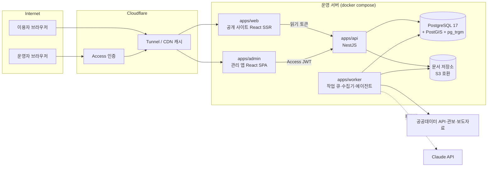

# 02. 시스템 구조

## 1. 구성 요소



| 구성 요소     | 역할                                                                                                                                                                                     | 공개 여부                                                  |
| ------------- | ---------------------------------------------------------------------------------------------------------------------------------------------------------------------------------------- | ---------------------------------------------------------- |
| `apps/web`    | 공개 사이트. 서버에서 API 를 불러 HTML 을 만든다(SSR).                                                                                                                                   | 공개(Cloudflare Tunnel)                                    |
| `apps/admin`  | 관리 앱. 전 개체 CRUD·첨부·지도(미래 지도 미리 보기·구글 위성 비교)·검수·이력.                                                                                                           | 비공개(Cloudflare Access 뒤, 관리자 1인)                   |
| `apps/api`    | NestJS. 읽기(공개 사이트용)·관리(CRUD·변경 묶음)·에이전트(제안) API. 검증·감사의 단일 관문.                                                                                              | 비공개                                                     |
| `apps/worker` | 작업 큐 처리: 파생 뷰 갱신, 백업·덤프, 기계적 수집기(시간표는 수동 실행만 — Q110 C), 에이전트 CLI 과제(수동 실행, 후순위), PDF 쪽 이미지·그림 잘라 내기. API 와 같은 도메인 코드를 쓴다. | 비공개                                                     |
| PostgreSQL    | **유일한 데이터 원천.** PostGIS(좌표·선형), pg_trgm(검색). OSM 데이터는 별도 스키마 `osm`.                                                                                               | 127.0.0.1                                                  |
| 문서 저장소   | 고시·보도자료 원문(PDF/HWP/이미지)·추출 텍스트·노선도 이미지·첨부 이미지·PDF 쪽 이미지·잘라 낸 그림. (Q39 A)                                                                             | 비공개(공개 가능 라이선스 원문·이미지는 web 경유 다운로드) |

## 2. 기술 스택 (추천안, 확정은 리뷰 후)

| 영역        | 선택                                                                                                                                                                  | 근거                                     | 리뷰      |
| ----------- | --------------------------------------------------------------------------------------------------------------------------------------------------------------------- | ---------------------------------------- | --------- |
| 언어        | TypeScript 5.x (strict) 전 영역                                                                                                                                       | 사용자 지정                              | —         |
| 런타임      | Node.js 24 LTS                                                                                                                                                        | 2026-11 기준 Active LTS                  | Q12 A     |
| 패키지      | pnpm workspaces + Turborepo                                                                                                                                           | 기존 pnpm 승계, 빌드 캐시                | Q12 A     |
| 공개 사이트 | **Next.js(App Router) SSR** + React 19                                                                                                                                | SEO·첫 화면 속도, API 비공개 유지(C-11)  | Q6 A      |
| 관리 앱     | **Vite + React 19 SPA** + TanStack Router·Query·Table + React Hook Form                                                                                               | 내부용, SEO 불필요, 빠른 개발 루프       | Q7 A      |
| UI          | Tailwind CSS v4 + shadcn/ui(Radix) 공용 디자인 시스템 `packages/ui`                                                                                                   | 두 앱 일관성, 접근성 기본 제공           | Q8 A      |
| 지도        | MapLibre GL JS + 배경 고르기(OSM 교통 지도(Thunderforest)·OSM 표준·VWorld 일반·위성, 기본 OSM 교통 지도 — 2026-11-24). 관리 앱 위성 비교만 Google Maps JavaScript API | 기존 결정 D16 승계, 구글은 관리 앱 전용  | Q13·Q68   |
| BE          | NestJS 11+ (Fastify 어댑터)                                                                                                                                           | 사용자 지정                              | —         |
| DB 접근     | **Drizzle ORM**(스키마 TS 정의·마이그레이션 `drizzle-kit`) + 필요한 곳 raw SQL                                                                                        | SQL 친화, PostGIS 커스텀 타입, 타입 추론 | Q9 A      |
| 계약(검증)  | **zod** 스키마를 `packages/contracts` 에 두고 BE(nestjs-zod)·FE(폼 검증) 공용, OpenAPI 생성                                                                           | 단일 정의                                | Q10·Q11 A |
| API 형식    | REST + OpenAPI 3.1, 생성 TS 클라이언트                                                                                                                                | 에이전트(MCP) 도구 노출에도 유리         | Q10 A     |
| DB          | PostgreSQL 17 + PostGIS 3.5 + pg_trgm (+ unaccent 불필요)                                                                                                             | 기존 승계                                | —         |
| 작업 큐     | **pg-boss**(PostgreSQL 기반 큐)                                                                                                                                       | 추가 인프라(Redis) 없음                  | Q14 A     |
| 문서 저장소 | S3 호환 SeaweedFS 자가 호스팅(외부 복제 Cloudflare R2)                                                                                                                | 251MB+ 원문, git 밖으로                  | Q39 A     |
| 테스트      | Vitest, Testcontainers(PostGIS), Playwright                                                                                                                           | 09 문서                                  | Q65 A     |
| LLM(후순위) | Claude API(`claude-opus-5-5` 조사·추출, `claude-haiku-5-5` 분류), MCP 서버                                                                                            | 08 문서                                  | Q56 A     |

## 3. 저장소 구조

```
k-raildex/
├─ apps/
│  ├─ web/            공개 사이트 (Next.js)
│  ├─ admin/          관리 앱 (Vite React SPA)
│  ├─ api/            NestJS API
│  └─ worker/         작업 처리기 (pg-boss consumer, 수집기, 에이전트 러너)
├─ packages/
│  ├─ contracts/      zod 스키마·DTO·enum 코드·라벨 (FE/BE 공용) ← 개체 규격의 단일 정의
│  ├─ db/             Drizzle 스키마·마이그레이션·뷰 SQL·시드(참조 테이블)
│  ├─ domain/         도메인 로직(검증 규칙, 파생 계산, 변경 묶음 적용기, 퍼지 날짜, 한글 초성) — api·worker 공용
│  ├─ api-client/     OpenAPI 생성 클라이언트 (web·admin·mcp 공용)
│  ├─ ui/             디자인 시스템 (Tailwind 토큰, shadcn 컴포넌트, 배지·퍼지 날짜 표시 등 도메인 UI)
│  ├─ map/            MapLibre 공용(스타일, 레이어 정의, VWorld 설정)
│  ├─ importers/      공공데이터 수집·정규화(TAGO, 레일포털, 관보, 연표 …) — 08 문서
│  ├─ migrate-legacy/ 기존 시스템 → 새 DB 이관 도구 (07 문서, 1회성이지만 반복 실행 가능)
│  └─ mcp/            (후순위) 에이전트용 MCP 서버
├─ docs/
├─ docker/            Dockerfile·compose
└─ .github/workflows/
```

의존 방향: `apps/* → packages/{api-client,ui,map,contracts}`, `apps/api·worker → packages/{domain,db,contracts,importers}`. `contracts` 는 다른 패키지에 의존하지 않는다.

## 4. 데이터 흐름

### 4-1. 읽기 (공개 사이트)

```
브라우저 → Cloudflare(캐시) → web(SSR) → API GET /v1/public/... → DB(정규 테이블 + 파생 뷰)
```

- web 은 페이지마다 필요한 개체만 요청한다(기존처럼 전체 컬렉션을 메모리에 올리지 않음).
- 캐시 무효화는 **데이터 판(data_version)** 으로: 쓰기가 커밋될 때마다 증가 → API 응답 헤더 `X-Data-Version`·ETag → web 의 fetch 캐시 태그 재검증 (Q52 A: 30초 이내).

### 4-2. 쓰기 (관리 앱)

```
관리 앱 폼 → API PATCH /v1/admin/stations/:id (If-Match: version)
  → 계약 검증(zod) → 도메인 검증(03 문서 8절) → 트랜잭션
      ├ 개체 행 갱신
      ├ changeset(1건, status applied) + change_op(전/후) 기록
      ├ data_version 증가
  → COMMIT → (비동기) 파생 물리화 뷰 갱신 작업 enqueue
```

- 모든 쓰기 경로는 **변경 묶음 적용기**(`packages/domain/changeset`) 하나를 지난다. 관리 앱의 단건 편집도 내부적으로 "op 1개짜리 변경 묶음"이다. → 감사·되돌리기·에이전트 제안을 한 모델로 처리.

### 4-3. 제안 (수집기·에이전트, 후순위)

```
worker(수집기/에이전트) → POST /v1/agent/changesets (status draft, 근거 첨부)
  → 관리 앱 검수 대기열 → 미리 보기(diff) → 승인 → 적용기 → applied
기계적 갱신(시간표 재수집 등) → worker 가 직접 적용(작성자 system, C-10)
```

## 5. 배포

| 서비스      | 이미지                                         | 포트(127.0.0.1) | 비고            |
| ----------- | ---------------------------------------------- | --------------- | --------------- |
| db          | postgis/postgis:17-3.5                         | 5433            | 볼륨, 일일 백업 |
| s3          | chrislusf/seaweedfs (Q39 A)                    | 8333            | 문서 저장소     |
| api         | apps/api                                       | 5100            |                 |
| worker      | apps/worker                                    | —               |                 |
| admin       | apps/admin(정적 파일 + nginx 또는 api 가 서빙) | 5200            | Access 뒤       |
| web         | apps/web                                       | 5000            | Tunnel 대상     |
| cloudflared | cloudflare/cloudflared                         | —               | 프로필 tunnel   |

- 기존 서버 1대 + docker compose + Cloudflare Tunnel 을 승계한다(Q61 A). 포트 5000 은 web.
- 관리 앱 완성 때 기존 시스템 데이터를 동결하고, 새 공개 사이트가 완성되면 기존 사이트를 닫고 새 사이트를 연다(07 문서 6절, Q5·Q67).

## 6. 환경 변수(초안)

| 변수                                                                                  | 사용처                                                | 비밀    |
| ------------------------------------------------------------------------------------- | ----------------------------------------------------- | ------- |
| `DATABASE_URL`                                                                        | api, worker                                           | O       |
| `S3_ENDPOINT`·`S3_BUCKET`·`S3_ACCESS_KEY`·`S3_SECRET_KEY`                             | api, worker                                           | O       |
| `PUBLIC_API_URL`·`WEB_API_TOKEN`                                                      | web                                                   | O(토큰) |
| `CF_ACCESS_TEAM_DOMAIN`·`CF_ACCESS_AUD`·`ADMIN_EMAIL`                                 | api(Access JWT 검증)                                  | O       |
| `VWORLD_API_KEY`                                                                      | web·admin(지도, 도메인 묶인 공개 키)                  | △       |
| `DATA_GO_KR_KEY`·`DATA_GO_KR_KEY_<서비스>`·`KRIC_KEY`·`SEOUL_OPEN_KEY`·`LAW_GO_KR_OC` | worker(수집기)·api(외부 API 탐색기, 서버가 주입·가림) | O       |
| `GOOGLE_MAPS_API_KEY`                                                                 | admin(위성 비교, 도메인 제한)                         | △       |
| `ANTHROPIC_API_KEY`                                                                   | worker(에이전트 CLI, 후순위, 월 30달러 상한)          | O       |
| `CLOUDFLARE_TUNNEL_TOKEN`                                                             | cloudflared                                           | O       |
| `SITE_URL`·`PUBLIC_ISSUES_URL`                                                        | web                                                   | —       |

`.env.example` 에 이름만 두고 실제 값은 커밋하지 않는다(C-8). 키 조회는 "서비스별 변수 → 공통 변수" 순서(기존 규칙 승계).
