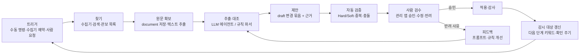

# 08. 수집기와 Closed Loop (후순위)

> 1차 구현 범위가 아니다. 다만 **스키마(변경 묶음 draft·근거·원문 문서)와 API(`/v1/agent/*`)는 1차에서 자리를 만들어 둔다** — 나중에 데이터 모델을 바꾸지 않기 위해.

## 1. 목표

"특정 노선·역·계획에 대한 정보를 찾아 자동으로 데이터를 추가"하는 순환:



## 2. 원칙

| ID         | 요구사항                                                                                                                                                                                           |
| ---------- | -------------------------------------------------------------------------------------------------------------------------------------------------------------------------------------------------- |
| FR-AGT-001 | **사실 변경은 사람이 승인한다**(C-10). 에이전트·수집기는 draft 만 만든다. 자동 적용은 기계적 갱신(시간표 재수집, 원문 색인 갱신, 파생 재계산)뿐. (Q55 A)                                         |
| FR-AGT-002 | **근거 없는 제안 금지.** 모든 op 에 원문 발췌(quote)·문서(document_id 또는 URL)·위치가 있어야 API 가 받는다. 원문은 제안 시점 스냅샷을 저장(sha256)해 링크가 죽어도 검수 가능.                     |
| FR-AGT-003 | **출처 우선순위 준수**(C-2). 에이전트는 1차 출처(관보·고시·국토부·공단·운영기관)를 먼저 찾고, 언론만 있으면 `review_status=unverified` + 신뢰도 표시, 위키 단독이면 제안하지 않는다(Q58 A). 기대 일정(plan_milestone)은 basis official·press 만 제안한다. |
| FR-AGT-004 | **외부 사이트 데이터 복제 금지**(미래철도DB 등). 에이전트 도구 허용 도메인 목록(allowlist)으로 강제.                                                                                               |
| FR-AGT-005 | **중복·충돌 방지**: 같은 개체를 바꾸는 미결 draft 가 있으면 새 제안은 그 묶음에 병합 제안 또는 거절. base_data_version 기록.                                                                       |
| FR-AGT-006 | **비용·횟수 상한**(Q59·Q84): **수동 명령으로 주 1회 정도** 실행, **월 30달러 상한**(관리 앱 설정에서 변경). 실행 전 이번 달 누적 비용을 확인해 넘으면 실행 거부, 실행 중 상한 도달 시 중단. 실행당 토큰·도구 호출 상한. 실행 기록(`ingest.run`)에 모델·토큰·비용·결과. 예약(cron) 실행은 두지 않는다.                                                          |
| FR-AGT-007 | **재현성**: 실행마다 프롬프트 버전·모델 id·입력 문서 sha256 기록.                                                                                                                                  |

## 3. 구성

### 3-1. 기계적 수집기 (규칙 기반, 기존 스크립트 이식)

| 수집기               | 근거 자료                         | 결과                                                                        | 반영               |
| -------------------- | --------------------------------- | --------------------------------------------------------------------------- | ------------------ |
| `tago-timetable`     | TAGO 지하철 시간표 API            | timetable_set/entry 교체                                                    | 자동               |
| `kric-train-ops`     | 레일포털 표준데이터 운행정보 xlsx | 토요일·2호선 내외선·열차번호 세트                                           | 자동               |
| `kric-gazette-index` | 철도산업정보센터 관보 목록        | 원문 색인(document) 갱신                                                    | 자동               |
| `gazette-watch`      | 관보 색인 × `plan_watch_keyword`  | 계획 단계 이력 제안(기본계획·실시계획·환경영향평가 공람 → 단계)             | draft              |
| `kric-chronology`    | 철도통합연표                      | 이벤트 제안                                                                 | draft              |
| `public-stations`    | 표준데이터·RAFIS·TAGO 역 목록     | 새 역·역명 변경·좌표 차이 제안(`external_ref` 로 대조, `ingest.match_rule`) | draft              |
| `geocode`            | VWorld                            | 근사 좌표 후보                                                              | draft(좌표는 사실) |

기존 `packages/pipeline/src/ingest/*` 중 위 기능만 `packages/importers` 로 이식한다(Q60 A). 1회성 시드 스크립트(계획 HWPX 시드, kilo-lines 생성)는 이식하지 않는다.

### 3-2. LLM 에이전트 (Q56 A·Q84 C)

**1단계 — MCP 서버 + 사람이 돌리는 에이전트** (가장 먼저, 위험 낮음)

- `packages/mcp`: 관리 API 를 도구로 노출하는 MCP 서버. 도구: `search_entities`, `get_entity`, `list_sources`, `fetch_document`(허용 도메인), `save_document`, `propose_changeset`(draft + 근거), `get_changeset_status`.
- 운영자가 Claude Code 등에서 "○○선 최신 단계 조사해서 제안 만들어" 식으로 실행 → 결과는 관리 앱 대기열에. 기존 운영 방식(사람·에이전트가 조사 → 변경 묶음 작성)을 그대로 API 로 옮긴 것.

**2단계 — CLI 정형 과제(수동 실행)**

- 관리자가 `pnpm agent:run <과제> [대상]` 으로 실행(주 1회 정도). worker 컨테이너 안에서 Claude API 도구 루프로 돌고, 결과는 draft 제안. 정형 과제는 CLI, 탐색형 조사(새 노선 자료 찾기 등)는 1단계 MCP 로 Claude Code 에서(Q84 C). 과제 우선순위(Q57): ③ new-plan-intake → ① plan-stage-refresh → ② opening-watch → ④ station-table-extract → ⑤ 철도통합연표 이벤트.
  - `plan-stage-refresh`: 미개통 계획마다 마지막 확인 이후 관보·국토부 보도·공단 사업현황을 찾아 단계 이력·**기대 일정**(예정 단계·시기, 발표 시점) 변경 제안.
  - `opening-watch`: 개통 목표가 임박한 노선·역 → 개통 확인 시 "개통 처리" 묶음(상태·개통일·merge_into 병합·이벤트) 제안.
  - `new-plan-intake`: 새 상위 계획 고시(5차 국가철도망 등) 원문 → 계획 사업 행 추출 → 기존 계획과 대조(related_plans 후보) → 대량 제안.
  - `station-table-extract`: 기본계획·실시계획 고시 원문의 정거장 표 → 공사 중 역·노선-역 후보 + 근사 좌표 질의.
  - `pdf-figure-extract`(Q39): 원본 PDF 를 쪽 이미지로 만들어 위치도·노선도·정거장 표·조감도를 찾아 잘라 낸 그림(파생 문서)과 표 전사를 근거·첨부 후보로 제안. 잘라 낸 그림의 공개 여부는 원본 라이선스 규칙(03 문서 4-3절)을 따른다.
  - `traced-geometry`: 공식 위치도 이미지에서 계획 선형을 추출(기존 route-trace 도구 방식)해 plan_geometry(traced) 제안 — 미래 지도 품질용.
- 모델: 추출·대조 `claude-opus-5-5`, 분류·필터 `claude-haiku-5-5`(비용 절감). 구조화 출력은 contracts 의 zod 스키마 → JSON Schema 를 도구 입력으로.

**3단계 — 품질 피드백**

- 반려 사유·승인 전 수정 내역을 집계해 과제별 프롬프트 개선, 자주 틀리는 유형을 규칙 검증(Soft)으로 승격.
- 지표: 제안 수, 승인율, 수정 후 승인율, 반려 사유 분포, 제안당 비용.

### 3-3. 데이터 (`ingest` 스키마)

```sql
CREATE SCHEMA ingest;
CREATE TABLE ingest.run (
  id bigint GENERATED ALWAYS AS IDENTITY PRIMARY KEY,
  task text NOT NULL,              -- tago-timetable, gazette-watch, agent:plan-stage-refresh ...
  trigger text NOT NULL,           -- schedule|manual|event
  status text NOT NULL,            -- running|done|failed|cancelled
  started_at timestamptz, finished_at timestamptz,
  params jsonb, stats jsonb,       -- 처리 건수, 제안 수
  model text, prompt_version text, input_tokens int, output_tokens int, cost_usd numeric(10,4),
  log text, error text,
  changeset_ids text[]             -- 만든 제안
);
CREATE TABLE ingest.config (       -- 수집기별 설정(기존 보정 파일 일부 이관)
  task text, key text, value jsonb NOT NULL, note text, PRIMARY KEY (task, key)
);
-- 예: ('kric-train-ops','routes', {...kric-train-ops-routes.yaml}), ('tago-timetable','route_services', {...}),
--     ('public-stations','kind_rules', {...station-kinds.rules}), ('korail-kilo','lines', {...})
CREATE TABLE ingest.match_rule (   -- 외부 레코드 ↔ 개체 대응 지시
  id bigint GENERATED ALWAYS AS IDENTITY PRIMARY KEY,
  kind text NOT NULL,              -- merge|no_merge
  keys text[] NOT NULL,            -- ['rafis:녹동','std:100@S2901']
  entity_id text REFERENCES entity(id),
  note text NOT NULL
);
CREATE TABLE ingest.snapshot (     -- 외부 데이터셋 정규화 스냅샷(차이 계산용)
  task text, external_key text, payload jsonb NOT NULL, sha256 text NOT NULL,
  first_seen_run bigint, last_seen_run bigint, PRIMARY KEY (task, external_key)
);
CREATE TABLE ingest.watch (        -- 감시 대상(개체별 다음 확인일·키워드)
  entity_id text REFERENCES entity(id) ON DELETE CASCADE,
  task text NOT NULL, next_check_at date, keywords text[], note text,
  PRIMARY KEY (entity_id, task)
);
```

## 4. 보안

- 에이전트 토큰 범위는 `proposal:write` + 읽기. 적용·삭제·사용자 관리 불가.
- 에이전트가 가져온 웹 문서는 **데이터로만** 취급(프롬프트 주입 방어): 문서 내용을 지시로 따르지 않도록 시스템 프롬프트·도구 설계, 도구 출력 길이 제한, 허용 도메인.
- API 키는 worker 환경 변수에만(C-8).

## 5. 단계별 완료 기준

| 단계          | 완료 기준                                                                                                         |
| ------------- | ----------------------------------------------------------------------------------------------------------------- |
| 기계적 수집기 | TAGO·운행정보 시간표 재수집이 예약 실행(LLM 비용 없음 — 예약 허용)되고, 결과가 기존 이관 데이터와 같은 형태로 교체됨. 실패 시 이전 세트 유지 |
| gazette-watch | 관보 새 고시 → 단계 제안 draft, 근거(고시 번호·제목·URL) 포함, 승인 시 단계 타임라인 반영                         |
| MCP 1단계     | Claude Code 에서 MCP 도구로 계획 1건 조사 → draft 제출 → 관리 앱 승인까지                                         |
| CLI 정형 과제 | `pnpm agent:run plan-stage-refresh` 를 주 1회 수동 실행, 월 30달러 안, 승인율·비용 지표 대시보드                     |
