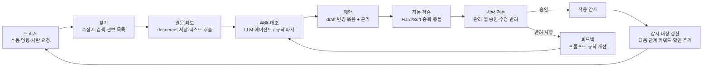

# 08. 수집기와 Closed Loop (후순위)

> 1차 구현 범위가 아니다. 다만 **스키마(변경 묶음 draft·근거·원문 문서)와 API(`/v1/agent/*`)는 1차에서 자리를 만들어 둔다** — 나중에 데이터 모델을 바꾸지 않기 위해.

## 1. 목표

"특정 노선·역·계획에 대한 정보를 찾아 자동으로 데이터를 추가"하는 순환:



## 2. 원칙

| ID         | 요구사항                                                                                                                                                                                                                                                                                              |
| ---------- | ----------------------------------------------------------------------------------------------------------------------------------------------------------------------------------------------------------------------------------------------------------------------------------------------------- |
| FR-AGT-001 | **사실 변경은 사람이 승인한다**(C-10). 에이전트·수집기는 draft 만 만든다. 자동 적용은 기계적 갱신(시간표 재수집, 원문 색인 갱신, 파생 재계산)뿐. (Q55 A)                                                                                                                                              |
| FR-AGT-002 | **근거 없는 제안 금지.** 모든 op 에 원문 발췌(quote)·문서(document_id 또는 URL)·위치가 있어야 API 가 받는다. 원문은 제안 시점 스냅샷을 저장(sha256)해 링크가 죽어도 검수 가능.                                                                                                                        |
| FR-AGT-003 | **출처 우선순위 준수**(C-2). 에이전트는 1차 출처(관보·고시·국토부·공단·운영기관)를 먼저 찾고, 언론만 있으면 `review_status=unverified` + 신뢰도 표시, 위키 단독이면 제안하지 않는다(Q58 A). 기대 일정(plan_milestone)은 basis official·press 만 제안한다.                                             |
| FR-AGT-004 | **외부 사이트 데이터 복제 금지**(미래철도DB 등). 에이전트 도구 허용 도메인 목록(allowlist)으로 강제.                                                                                                                                                                                                  |
| FR-AGT-005 | **중복·충돌 방지**: 같은 개체를 바꾸는 미결 draft 가 있으면 새 제안은 그 묶음에 병합 제안 또는 거절. base_data_version 기록.                                                                                                                                                                          |
| FR-AGT-006 | **비용·횟수 상한**(Q59·Q84): **수동 명령으로 주 1회 정도** 실행, **월 30달러 상한**(관리 앱 설정에서 변경). 실행 전 이번 달 누적 비용을 확인해 넘으면 실행 거부, 실행 중 상한 도달 시 중단. 실행당 토큰·도구 호출 상한. 실행 기록(`ingest.run`)에 모델·토큰·비용·결과. 예약(cron) 실행은 두지 않는다. |
| FR-AGT-007 | **재현성**: 실행마다 프롬프트 버전·모델 id·입력 문서 sha256 기록.                                                                                                                                                                                                                                     |

## 3. 구성

### 3-1. 기계적 수집기 (규칙 기반, 기존 스크립트 이식)

| 수집기               | 근거 자료                         | 결과                                                                        | 반영               |
| -------------------- | --------------------------------- | --------------------------------------------------------------------------- | ------------------ |
| `tago-timetable`     | TAGO 지하철 시간표 API            | timetable_set/entry 교체                                                    | 자동               |
| `kric-train-ops`     | 레일포털 표준데이터 운행정보 xlsx | 토요일·2호선 내외선·열차번호 세트(TAGO 에 없는 조합만)                      | 자동               |
| `osm-rail`           | OSM Overpass(기존 추출 파일)      | `osm` 스키마 전체 교체(way·relation·member, ODbL)                           | 자동(참고 데이터)  |
| `kric-gazette-index` | 철도산업정보센터 관보 목록        | 원문 색인(document) 갱신                                                    | 자동               |
| `gazette-watch`      | 관보 색인 × `plan_watch_keyword`  | 계획 단계 이력 제안(기본계획·실시계획·환경영향평가 공람 → 단계)             | draft              |
| `kric-chronology`    | 철도통합연표                      | 이벤트 제안                                                                 | draft              |
| `public-stations`    | 표준데이터·RAFIS·TAGO 역 목록     | 새 역·역명 변경·좌표 차이 제안(`external_ref` 로 대조, `ingest.match_rule`) | draft              |
| `geocode`            | VWorld                            | 근사 좌표 후보                                                              | draft(좌표는 사실) |

기존 `packages/pipeline/src/ingest/*` 중 위 기능만 `packages/importers` 로 이식한다(Q60 A). 1회성 시드 스크립트(계획 HWPX 시드, kilo-lines 생성)는 이식하지 않는다.

#### 3-1-1. 구현 현황 (WP 8.1~8.3, 2026-11-21)

| 구성             | 위치(`packages/importers/src`) | 내용                                                                                                                                                                                                                                                                                                                                                                                                                                                                                                                                                                                                                                                                                                                                                                                                                                                                            |
| ---------------- | ------------------------------ | ------------------------------------------------------------------------------------------------------------------------------------------------------------------------------------------------------------------------------------------------------------------------------------------------------------------------------------------------------------------------------------------------------------------------------------------------------------------------------------------------------------------------------------------------------------------------------------------------------------------------------------------------------------------------------------------------------------------------------------------------------------------------------------------------------------------------------------------------------------------------------- |
| 실행 기록        | `core/run.ts`                  | `ingest.run` running → done/failed, `params`·`stats`·`log`(마크다운 리포트)·`error`. dry-run 은 기록하지 않는다. 기록은 쓰기 트랜잭션 밖이라 실패도 남는다                                                                                                                                                                                                                                                                                                                                                                                                                                                                                                                                                                                                                                                                                                                      |
| 키·HTTP          | `core/keys.ts`·`core/http.ts`  | 키 = 엔드포인트 `key_env`(서비스별) → 공통 변수(`DATA_GO_KR_KEY` 등). `ApiClient`: 엔드포인트 카탈로그(`ingest.api_endpoint`, 없으면 기본 정의로 만든다) 기준, 시도마다 `ingest.api_call`(origin importer, 키 제외 params, 응답 본문·sha256) 기록, 오늘(Asia/Seoul) 호출 수가 `daily_limit`·실행 상한(`--max-calls`, 기본 9,000)에 닿으면 `LimitReached`. 429 = 4초×n, 5xx·네트워크 = 1.5초×n 재시도(최대 7회), 키 오류(20·30·31·12)는 바로 중단                                                                                                                                                                                                                                                                                                                                                                                                                                |
| 스냅샷           | `core/snapshot.ts`             | 외부 키(TAGO 역 ID, 운행정보 노선번호)마다 정규화 행의 sha256(키 순서 고정 JSON) → `ingest.snapshot`(payload 는 요약만). 실행 통계에 new/changed/same                                                                                                                                                                                                                                                                                                                                                                                                                                                                                                                                                                                                                                                                                                                           |
| 시간표 쓰기      | `timetable/writer.ts`          | 한 트랜잭션: 범위(출처 + (역·노선코드·노선코드 접두) 조건) 안 세트 삭제 → 세트·행(ord = 배열 순서) 삽입, `import_run_id` = 실행 id. 실패하면 ROLLBACK(이전 세트 유지). 같은 입력이면 같은 결과(멱등). 다른 것(파생 갱신 등)은 하지 않는다                                                                                                                                                                                                                                                                                                                                                                                                                                                                                                                                                                                                                                       |
| `tago-timetable` | `timetable/tago.ts`            | raw(`<TAGO ID>.json.gz`, 기존 fetch-tago-timetable 형식) 또는 실시간 API(역마다 요일 01·02·03 × 방향 U·D, 페이지 500행, 대상 = `external_ref` tago_subway, 기본 수도권). 묶음·시각(04시 전 = 24~27시)·방향 재정의·방면 라벨 규칙은 기존 build-timetables.ts 와 같다. 교체 범위 = 처리한 TAGO 역의 (역, 응답 노선코드) + (역, TAGO ID 접두 노선코드). 설정 `ingest.config (tago-timetable, route_services)`                                                                                                                                                                                                                                                                                                                                                                                                                                                                      |
| `kric-train-ops` | `timetable/kric.ts`            | 노선번호별 정규화 json.gz(`all-<노선번호>.json.gz`) → TAGO 에 없는 (역, 운행 계통, 요일, 방향)만 세트(토요일·2호선 공휴일·내선/외선 등). 행에 열차번호(`train_no`)·운행유형(`note` 급행·직통)·종착역(`dest_station_id`), 세트 `day_note` 에 원문 요일구분. 수도권 계통만(Q85 A). 교체 범위 = 출처 + 처리한 노선번호. 설정 `ingest.config (kric-train-ops, routes)`(기존 kric-train-ops-routes.yaml)·`(kric-train-ops, rafis_abbr)`(RAFIS 역약어명)                                                                                                                                                                                                                                                                                                                                                                                                                              |
| `osm-rail`       | `osm/rail.ts`                  | 기존 저장소 추출 파일(`--from-raw <dir>`, 기본 `LEGACY_ROOT/data/osm`: rail-ways.geojson·rail-construction-kr.geojson·rail-routes.json·manifest.json) 또는 `--live`(Overpass 직접 호출, 기존 fetch-osm-rail.ts 쿼리 5개, node:https IPv4·429/5xx 재시도 — 새 의존성 없음, `--endpoint` 로 미러 지정). 파일(묶음)마다 `osm.extract` 1행(sha256 = 파일 원문, fetched_at = 추출 시각, note 에 OSM 기준 시각·건수). way 태그 = 추출 속성(osm_id 제외), `is_construction` = `railway=construction`(construction=* 만 남은 운영 way 제외), 공사 중 파일은 rail-ways 에 없는 way 만 더함. relation_member = member way 순서(role 은 추출에 없어 NULL), 하위 relation 구성원은 기존 build-map 처럼 쓰지 않음(통계만). 한 트랜잭션으로 osm 스키마 전체 교체(실패 = ROLLBACK, 이전 추출 유지) → `refresh_derived()` → 리포트에 배정 노선 수·근사 좌표 역 스냅 수·계획 osm_construction 수 |
| CLI              | `cli.ts`                       | `pnpm -F @k-raildex/importers run <tago-timetable\|kric-train-ops\|osm-rail> [--from-raw <dir>] [--from-xlsx <file\|dir> [--download]] [--dry-run] [--ids …] [--line-nos …] [--area capital\|all] [--limit N] [--max-calls N] [--live] [--endpoint <url>]`                                                                                                                                                                                                                                                                                                                                                                                                                                                                                                                                                                                                                      |
| worker           | `tasks.ts`, `apps/worker`      | 큐 `importer.run`, payload `{ task, options }`(zod 검사), 재시도 없음(실패 = 이전 세트 유지 + run failed). **예약(schedule) 없음 — 수동 실행만**(CLI 또는 관리 앱 작업 화면, Q110 C). 운영기관 개정 공지 때 관리자가 돌린다                                                                                                                                                                                                                                                                                                                                                                                                                                                                                                                                                                                                                                                     |
| 이관 도구        | `packages/migrate-legacy`      | TAGO 세트는 `buildTagoSets`(같은 구현)로 만들고, 적재 단계에서 수집기 설정을 `ingest.config` 에 넣은 뒤(`migrate:config` 로 따로도) `kric-train-ops` 를 DB 에 대해 실행한다(Q104 A)                                                                                                                                                                                                                                                                                                                                                                                                                                                                                                                                                                                                                                                                                             |

- **역명 해석 순서(kric-train-ops)**: `names`(수기, 노선번호별) → 운행 계통 노선·정차 패턴 역(미개통 제외)의 이름·별칭(`entity_name` alias) → RAFIS 역약어명 → 역명(후보 이름 또는 `external_ref` rafis 코드) → 앞 글자(숫자·"지하"·"신" 제거) 접두 일치 → 전역 유일 이름. 못 푼 역명은 실행 통계 `unresolved_names`·리포트 표.
- **방향(kric-train-ops)**: `direction_rule: loop`(2호선) = 정차 순서의 역번호(200번대) 증가 = inner, 감소 = outer → 종착역의 TAGO 방향 투표 → 기점·종점의 정차 패턴 순서(앞 → 뒤 = down) → **정차역 중 정차 패턴에 있는 첫·끝 역 순서**(새 규칙: 이관 때 패턴에서 빠진 역이 기점·종점이거나 종점 역명을 못 풀 때) → unknown.
- **운행정보 원본 xlsx(Q108 A)**: `kric-train-ops --from-xlsx <파일|디렉터리>` 가 원본 xlsx(레일포털 파일데이터 id 900 "표준데이터 운행정보")를 exceljs 스트리밍 해석기로 읽어 정규화한다(`timetable/kric-xlsx.ts`, 기존 fetch-kric-train-ops.ts 이식 — 역마다 1행/열차 1편 1행 두 모양, 항목 앞 순번·역번호 제거, 노선번호 행 5개 미만은 셀 깨짐으로 건너뜀). `--download` 를 더하면 키 없이 레일포털에서 받아 그 디렉터리에 `kric-filedata-900.xlsx` 로 저장한 뒤 읽는다(원본 sha256·크기·행 수는 실행 기록 stats.xlsx). 대조(2026-11-21): 다시 받은 원본(sha256 `218f76dd…`, 기존 manifest 와 같음)의 정규화 결과가 기존 저장소 json.gz 38개와 `retrieved_at` 밖에 모두 같다. `--from-raw <json.gz 디렉터리>` 도 그대로 쓴다.
- **아직 없는 것**: TAGO 실시간 경로는 키가 없어 가짜 fetch 시험으로만 확인했다.
- **첫 실행(2026-11-21, 개발 DB)**: `kric-train-ops` 세트 1,227·행 174,509(기존 1,323세트 중 1,223 + 새 4, 방향 unknown 100세트는 정차역 순서로 상·하행이 정해져 TAGO 중복으로 생략), 미해석 역명 9종 9행(원본 셀 글자 깨짐 7, 오기 "센럴파크" 1, 역번호가 붙은 "215인천가좌" 1 — 기존 빌드와 같은 목록 + 기존에 못 푼 "신촌"(2호선)은 이번에 풀림). `tago-timetable --from-raw` 재실행 세트 2,926·행 430,909(이관 결과와 같음).
- **round-04 반영 뒤 재이관(2026-11-21, 개발 DB)**: 역명 보정(Q107 `당고개 → stn-buramsan`, Q109 "센럴파크"·"215인천가좌")으로 미해석 역명 9종 → 7종(깨진 셀만, 리포트만). 세트 수는 그대로(TAGO 세트 2,926·행 430,909 + 운행정보 1,227·174,509 = 4,153·605,418 — 새로 풀린 행은 TAGO 가 덮는 조합). `--from-xlsx` 실행의 스냅샷은 json.gz 실행과 38개 모두 same.
- **osm-rail 첫 실행(2026-11-21, 개발 DB, 기존 추출 2026-10-13)**: way 14,941(rail 13,769·subway 593·monorail 94·light_rail 99·construction 386, 공사 중 파일에서 더한 way 0 — 전국 추출에 이미 포함), relation 434, member way 39,893(추출 밖 way 1,551, 하위 relation 구성원 3 생략). 배정 결과(0017 뷰 수정 뒤): `line_osm_map` 98노선 중 선형 있음 96(없음: 대경선 — 매핑 비어 있음, 시흥연결선 — 기존 `claim_first` 가 계약에 없어 경부고속선 relation 이 먼저 차지), 배정 way 13,245, `mv_map_line` 101행(운영 선형 77노선·공사 중 선형 24노선), 근사 좌표 역 스냅 93/102(parcel 47/55 · district 40/41 · township 6/6), `v_plan_shape` osm_construction 20(schematic 60·traced 18). `migrate:verify` 결과는 적재 전후 같음(Hard 0·미설명 차이 0·단계 불일치 4). `refresh_derived()` 는 OSM 적재 뒤 약 14초.
- **OSM 적재로 드러난 뷰 오류(0017_osm_line_way_plan_shape.sql)**: `osm.v_line_way` 가 `bbox` 를 way 이름 후보에만 적용해 relation 을 bbox 로 나눈 노선(7호선 인천 구간·8호선 별내선)이 relation 전체를 차지했다 → bbox 는 relation 구성원에도, 판정은 기존 wayCenter(가운데 꼭짓점)로. way 이름은 name·name:ko 둘 다(기존 규칙). `v_plan_shape` 의 OSM 공사 선형 ST_Collect 가 GeometryCollection 이 되어 geom 을 읽는 질의(`map_at_lines` 포함)가 실패했다 → ST_CollectionExtract.
- **아직 없는 것(OSM)**: 기존 osm-line-map.yaml 의 `ways`(way id 직접 지정)·`claim_first`·`share_with`(공용 구간 겹쳐 그리기)는 계약(`line_osm_map`)에 열이 없어 이관 때 note 로만 남았다 — 시흥연결선 선형이 비는 원인. 실시간(`--live`) 경로는 가짜 응답 시험으로만 확인했다(Overpass 부하 때문에 분기마다 수동 실행).

### 3-2. LLM 에이전트 (Q56 A·Q84 C)

**1단계 — MCP 서버 + 사람이 돌리는 에이전트** (가장 먼저, 위험 낮음)

- `packages/mcp`: 관리 API 를 도구로 노출하는 MCP 서버. 도구: `search_entities`, `get_entity`, `list_sources`, `fetch_document`(허용 도메인), `save_document`, `propose_changeset`(draft + 근거), `get_changeset_status`.
- 운영자가 Claude Code 등에서 "○○선 최신 단계 조사해서 제안 만들어" 식으로 실행 → 결과는 관리 앱 대기열에. 기존 운영 방식(사람·에이전트가 조사 → 변경 묶음 작성)을 그대로 API 로 옮긴 것.

**2단계 — CLI 정형 과제(수동 실행)**

- 관리자가 `pnpm agent:run <과제> [대상]` 으로 실행(주 1회 정도). worker 컨테이너 안에서 Claude API 도구 루프로 돌고, 결과는 draft 제안. 정형 과제는 CLI, 탐색형 조사(새 노선 자료 찾기 등)는 1단계 MCP 로 Claude Code 에서(Q84 C). 과제 우선순위(Q57): ③ new-plan-intake → ① plan-stage-refresh → ② opening-watch → ④ station-table-extract → ⑤ 철도통합연표 이벤트.
  - `plan-stage-refresh`: 미개통 계획마다 마지막 확인 이후 관보·국토부 보도·공단 사업현황을 찾아 단계 이력·**기대 일정**(예정 단계·시기, 발표 시점) 변경 제안.
  - `opening-watch`: 개통 목표가 임박한 노선·역 → 개통 확인 시 "개통 처리" 묶음(상태·개통일·merge_into 병합·이벤트) 제안.
  - `new-plan-intake`: 새 상위 계획 고시(5차 국가철도망 등) 원문 → 계획 사업 행 추출 → 기존 계획과 대조(related_plans 후보) → 대량 제안.
  - `station-table-extract`: 기본계획·실시계획 고시 원문의 정거장 표 → 공사 중 역·노선-역 후보 + 근사 좌표 질의.
  - `pdf-figure-extract`(Q39): 원본 PDF 를 쪽 이미지로 만들어 위치도·노선도·정거장 표·조감도를 찾아 잘라 낸 그림(파생 문서)과 표 전사를 근거·첨부 후보로 제안. 잘라 낸 그림의 공개 여부는 원본 라이선스 규칙(03 문서 4-3절)을 따른다.
  - `traced-geometry`: 공식 위치도 이미지에서 계획 선형을 추출(기존 route-trace 도구 방식)해 plan_geometry(traced) 제안 — 미래 지도 품질용.
- 모델: 추출·대조 `claude-opus-5-5`, 분류·필터 `claude-haiku-5-5`(비용 절감). 구조화 출력은 contracts 의 zod 스키마 → JSON Schema 를 도구 입력으로.

**3단계 — 품질 피드백**

- 반려 사유·승인 전 수정 내역을 집계해 과제별 프롬프트 개선, 자주 틀리는 유형을 규칙 검증(Soft)으로 승격.
- 지표: 제안 수, 승인율, 수정 후 승인율, 반려 사유 분포, 제안당 비용.

### 3-3. 데이터 (`ingest` 스키마)

```sql
CREATE SCHEMA ingest;
CREATE TABLE ingest.run (
  id bigint GENERATED ALWAYS AS IDENTITY PRIMARY KEY,
  task text NOT NULL,              -- tago-timetable, gazette-watch, agent:plan-stage-refresh ...
  trigger text NOT NULL,           -- schedule|manual|event
  status text NOT NULL,            -- running|done|failed|cancelled
  started_at timestamptz, finished_at timestamptz,
  params jsonb, stats jsonb,       -- 처리 건수, 제안 수
  model text, prompt_version text, input_tokens int, output_tokens int, cost_usd numeric(10,4),
  log text, error text,
  changeset_ids text[]             -- 만든 제안
);
CREATE TABLE ingest.config (       -- 수집기별 설정(기존 보정 파일 일부 이관)
  task text, key text, value jsonb NOT NULL, note text, PRIMARY KEY (task, key)
);
-- 예: ('kric-train-ops','routes', {...kric-train-ops-routes.yaml}), ('tago-timetable','route_services', {...}),
--     ('public-stations','kind_rules', {...station-kinds.rules}), ('korail-kilo','lines', {...})
CREATE TABLE ingest.match_rule (   -- 외부 레코드 ↔ 개체 대응 지시
  id bigint GENERATED ALWAYS AS IDENTITY PRIMARY KEY,
  kind text NOT NULL,              -- merge|no_merge
  keys text[] NOT NULL,            -- ['rafis:녹동','std:100@S2901']
  entity_id text REFERENCES entity(id),
  note text NOT NULL
);
CREATE TABLE ingest.snapshot (     -- 외부 데이터셋 정규화 스냅샷(차이 계산용)
  task text, external_key text, payload jsonb NOT NULL, sha256 text NOT NULL,
  first_seen_run bigint, last_seen_run bigint, PRIMARY KEY (task, external_key)
);
CREATE TABLE ingest.watch (        -- 감시 대상(개체별 다음 확인일·키워드)
  entity_id text REFERENCES entity(id) ON DELETE CASCADE,
  task text NOT NULL, next_check_at date, keywords text[], note text,
  PRIMARY KEY (entity_id, task)
);
```

## 4. 보안

- 에이전트 토큰 범위는 `proposal:write` + 읽기. 적용·삭제·사용자 관리 불가.
- 에이전트가 가져온 웹 문서는 **데이터로만** 취급(프롬프트 주입 방어): 문서 내용을 지시로 따르지 않도록 시스템 프롬프트·도구 설계, 도구 출력 길이 제한, 허용 도메인.
- API 키는 worker 환경 변수에만(C-8).

## 5. 단계별 완료 기준

| 단계          | 완료 기준                                                                                                                            |
| ------------- | ------------------------------------------------------------------------------------------------------------------------------------ |
| 기계적 수집기 | TAGO·운행정보 시간표 재수집을 수동 실행(Q110 C — 예약 없음)하면 결과가 기존 이관 데이터와 같은 형태로 교체됨. 실패 시 이전 세트 유지 |
| gazette-watch | 관보 새 고시 → 단계 제안 draft, 근거(고시 번호·제목·URL) 포함, 승인 시 단계 타임라인 반영                                            |
| MCP 1단계     | Claude Code 에서 MCP 도구로 계획 1건 조사 → draft 제출 → 관리 앱 승인까지                                                            |
| CLI 정형 과제 | `pnpm agent:run plan-stage-refresh` 를 주 1회 수동 실행, 월 30달러 안, 승인율·비용 지표 대시보드                                     |
