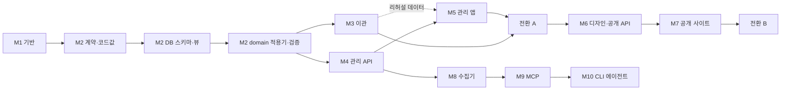

# 11. 상세 구현 계획

- 작성일: 2026-11-20
- 근거: 설계 확정본 docs/01~10, 결정 표 [decisions.md](decisions.md)(Q1~Q96)
- 범위: M1~M5(1차: 기반 → 스키마 → 이관 → 관리 API → 관리 앱)는 작업 패키지(WP) 단위로 상세히, M6~M10 은 WP 목록과 완료 기준까지.
- 크기 표기: **S** ≤ 반나절, **M** 1~2일, **L** 3~5일(1인 기준 대략치, 일정 약속 아님).

## 0. 작업 방식

| 항목           | 규칙                                                                                                                                                                                                                                                                                |
| -------------- | ----------------------------------------------------------------------------------------------------------------------------------------------------------------------------------------------------------------------------------------------------------------------------------- |
| 브랜치         | `main` 보호. WP 마다 `feat/<m>-<wp>-<slug>` 브랜치 → PR → CI 통과 후 병합. 큰 WP 는 여러 PR.                                                                                                                                                                                        |
| 완료 정의(DoD) | ① 타입 검사·lint·단위·통합 시험 통과 ② 설계 문서와 어긋나면 문서를 먼저 고침 ③ 새 코드값·테이블은 03 문서 반영 ④ 공개 API·계약 변경은 OpenAPI 스냅샷 갱신                                                                                                                           |
| 문서           | 구현 중 결정이 필요한 선택은 `docs/review/notes.md` 에 적고 다음 라운드 질문으로. 결정이 아닌 것은 바로 처리.                                                                                                                                                                       |
| 시험 데이터    | `packages/domain/src/fixtures.ts`(도메인 적용기로 넣는 일관된 소규모 데이터 — db 패키지가 domain 에 의존하면 순환이라 domain 에 둠) — 통합 시험·E2E 공용. 실제 이관 데이터는 리허설 DB 에서만.                                                                                      |
| 버전           | 착수 시점 최신 안정판을 `package.json` 에 정확한 버전으로 고정. 주 버전 기준: Node 24 LTS, pnpm 12, TypeScript 6.0(typescript-eslint 지원 범위), React 19, Next.js 16, NestJS 12(기존 시스템과 같음), Vite 7, Tailwind 4, zod 4, Drizzle ORM, pg-boss, PostgreSQL 17 + PostGIS 3.5. |

## 1. 의존 관계

M3(이관)과 M4(관리 API)는 M2 이후 **병행 가능**하다. 관리 앱 개발(M5)은 픽스처로 시작하고, 이관 리허설 DB 가 준비되면 실제 데이터로 확인한다.

---

## 2. M1 — 기반

| WP                 | 크기 | 내용                                                                                                                                                                                                                                                                                | 산출물                                                   | 완료 기준                      |
| ------------------ | ---- | ----------------------------------------------------------------------------------------------------------------------------------------------------------------------------------------------------------------------------------------------------------------------------------- | -------------------------------------------------------- | ------------------------------ |
| 1.1 저장소 골격    | M    | pnpm workspace, Turborepo(`build`·`check`·`test`·`lint` 파이프라인), `tsconfig.base.json`(strict, ESM, `moduleResolution: bundler`/`nodenext` 앱별), 경로: `apps/{web,admin,api,worker}`, `packages/{contracts,db,domain,api-client,ui,map,importers,migrate-legacy,mcp}` 빈 패키지 | 루트 `package.json`, `pnpm-workspace.yaml`, `turbo.json` | `pnpm i && pnpm check` 통과    |
| 1.2 품질 도구      | S    | ESLint(flat config, typescript-eslint), Prettier(기존 문서 포맷과 동일 설정), Vitest 공용 설정, `.editorconfig`, `lint-staged` + `simple-git-hooks`(pre-commit: prettier·eslint, gitleaks)                                                                                          | `eslint.config.js`, `vitest.workspace.ts`                | 빈 시험 1건 통과               |
| 1.3 로컬 인프라    | M    | `docker/compose.dev.yml`: `db`(postgis/postgis:17-3.5, 127.0.0.1:5440 — 5433·5434 는 같은 서버의 다른 프로젝트가 사용), `s3`(SeaweedFS 4.54, 127.0.0.1:8333, 자격 증명 `docker/seaweedfs/s3.json` — 개발 전용 값). `.env.example`(02 문서 6절 변수 전부, 값 없음). `pnpm dev:infra` | compose 파일, `.env.example`                             | `pnpm dev:infra` 후 DB·S3 접속 |
| 1.4 CI             | M    | GitHub Actions: PR = install(캐시) → lint → check → unit → integration(서비스 컨테이너 대신 Testcontainers) → build → gitleaks. 야간 워크플로 자리(이관 리허설, M3 에서 채움)                                                                                                       | `.github/workflows/ci.yml`, `nightly.yml`                | PR 에서 녹색                   |
| 1.5 기존 문서 보관 | S    | `docs/legacy/` 에 future-rail-db 의 `docs/{TERMINOLOGY,SOURCES,REFERENCE,PLAN}.md`, `docs/design/*`, `docs/research/*`, `docs/review/*`, `CLAUDE.md` 복사(읽기 전용 표기 머리말)                                                                                                    | `docs/legacy/**`                                         | 링크 확인                      |
| 1.6 프로젝트 규칙  | S    | `CLAUDE.md`(이 저장소용): 설계 문서 우선, 결정 질문 절차, 정확성 원칙(C-1~C-13 요약), 비밀값 규칙, 시험·커밋 규칙                                                                                                                                                                   | `CLAUDE.md`                                              | —                              |

## 3. M2 — 스키마

### 3-1. `packages/contracts` (zod·코드값)

| WP                | 크기 | 내용                                                                                                                                                                                                                                                                                                                                                                                                                                                       |
| ----------------- | ---- | ---------------------------------------------------------------------------------------------------------------------------------------------------------------------------------------------------------------------------------------------------------------------------------------------------------------------------------------------------------------------------------------------------------------------------------------------------------- |
| 2.1 코드값        | M    | `src/codes.ts`: 03 문서 5절 모든 도메인을 `as const` 배열 + 라벨(ko)·순서·설명. `plan_stage` 진행도 순서, `area`·`entity_type` 포함. CHECK 생성 함수 `toCheck(domain)`                                                                                                                                                                                                                                                                                     |
| 2.2 공용 스키마   | M    | `fuzzyDate`(형식 검증·정규화·from/to 계산 함수 공용), `names`, `idOf(prefix)`(접두사별 정규식, 03 문서 2-1절), `rec`, `sourceLink`(record_source 행), `entityName`, `externalRef`, `attachment`                                                                                                                                                                                                                                                            |
| 2.3 개체 계약     | L    | 개체별 `Create`/`Update`(부분)/`Read`(관계 포함 + `version` + `derived`) 스키마: source, operator, station, line_station, line, train_class, service(+service_line, stop_pattern), plan_program(+notice/point/figure), plan(+ref/stage_event/milestone/line/station/region/relation/geometry/watch_keyword), event(+target/area), train_number_range, rolling_stock_range, transfer_center(+하위), route_map, glossary_term, document, timetable_set(읽기) |
| 2.4 UI 메타데이터 | M    | 개체별 폼 그룹·위젯 지정(`src/ui-meta/*.ts`: 필드 → 위젯 종류·라벨·설명·그룹·순서). **모든 계약 필드가 메타데이터에 있는지 검사하는 시험**(FR-ADM-021)                                                                                                                                                                                                                                                                                                     |
| 2.5 API 계약      | M    | 목록 쿼리·페이지 응답·오류 형식·변경 묶음(op 종류별 payload)·여러 건 입력 요청/응답·공개 API 읽기 모델(1차는 관리용만, 공개 모델은 M6)                                                                                                                                                                                                                                                                                                                     |

### 3-2. `packages/db` (Drizzle·SQL)

마이그레이션 파일 순서(각각 하나의 PR 단위로 묶을 수 있음):

| 순서 | 파일                       | 내용                                                                                                                                                                                                          | 크기 |
| ---- | -------------------------- | ------------------------------------------------------------------------------------------------------------------------------------------------------------------------------------------------------------- | ---- |
| 0001 | `extensions_functions.sql` | postgis, pg_trgm, pgcrypto. 함수: `fuzzy_valid/from/to`(IMMUTABLE), `hangul_chosung(text)`, `updated_at` 트리거 함수                                                                                          | M    |
| 0002 | `system.sql`               | app_user, api_token, changeset, change_op, change_evidence, data_version, app_setting, **entity**(레지스트리), id_redirect                                                                                    | S    |
| 0003 | `reference.sql`            | ref_area, ref_region, ref_external_system                                                                                                                                                                     | S    |
| 0004 | `source_document.sql`      | source, document, source_document                                                                                                                                                                             | M    |
| 0005 | `common_links.sql`         | entity_name, external_ref, record_source, entity_attachment                                                                                                                                                   | M    |
| 0006 | `network.sql`              | operator, station, line, line_region, line_operator, line_osm_map, line_station                                                                                                                               | L    |
| 0007 | `service.sql`              | train_class, service, service_line, stop_pattern, stop_pattern_stop                                                                                                                                           | M    |
| 0008 | `plan.sql`                 | plan_program(+3), plan(+ref·stage_event·milestone·line·station·region·relation·geometry·watch_keyword)                                                                                                        | L    |
| 0009 | `misc.sql`                 | event(+target·area), train_number_range(+2), rolling_stock_range(+2), transfer_center(+4), route_map, glossary_term                                                                                           | M    |
| 0010 | `timetable.sql`            | timetable_set, timetable_entry                                                                                                                                                                                | S    |
| 0011 | `osm_ingest.sql`           | 스키마 osm(extract·way·relation·relation_member), ingest(run·config·match_rule·snapshot·watch·api_endpoint·api_call·api_preset)                                                                               | M    |
| 0012 | `triggers.sql`             | entity_type_guard, 출처 ≥1 지연 제약 트리거, 소프트 삭제 시 entity.deleted_at 동기·노선 삭제 시 노선역 표시, 첨부 공개 ↔ 문서 publishable(V-H15), plan_geometry via 역 존재                                   | L    |
| 0013 | `views.sql`                | v_station_status, v_station_line, v_station_line_class, v_station_service, 권역 뷰 4종, v_station_review, v_plan_stage, v_plan_target_open, v_unopened_target, v_plan_shape, v_event_all, v_timetable_summary | L    |
| 0014 | `map_views.sql`            | `map_at(year, opts)` SQL 함수(03 문서 6-1절 규칙) + `osm.v_line_geometry`                                                                                                                                     | L    |
| 0015 | `mviews.sql`               | mv_search, mv_map_station, mv_map_line(+ UNIQUE 인덱스, CONCURRENTLY 갱신용)                                                                                                                                  | M    |

| WP                    | 크기 | 내용                                                                                                                                                                                                                                           |
| --------------------- | ---- | ---------------------------------------------------------------------------------------------------------------------------------------------------------------------------------------------------------------------------------------------- |
| 2.6 Drizzle 헬퍼      | M    | `fuzzy('x')`, `names()`, `rec()`, `meta()`, `geography('Point')`·`geometry('MultiLineString')` 커스텀 타입, 코드값 CHECK 생성. 테이블 정의는 `src/schema/*.ts`, 뷰·함수·트리거는 `sql/` 원문 파일을 마이그레이션에 포함                        |
| 2.7 마이그레이션 도구 | S    | `pnpm db:migrate`(drizzle-kit migrate + sql 파일 순서 적용), `pnpm db:reset`(개발용), 마이그레이션 전 자동 백업 훅(운영)                                                                                                                       |
| 2.8 참조 시드         | S    | ref_area 8, ref_region 17(행정표준코드·이름·약칭·슬러그·권역 — 기존 region.ts 와 대조), ref_external_system(tago_subway, kric_std, rafis, kric_route, molit_line_no, kr_line_no, korail_station_kilo, korail_kilo_line …)                      |
| 2.9 픽스처            | M    | `fixtures/*.ts` — 계약 Create 형태로 작성, 도메인 적용기로 적재(적용기 시험 겸용). 환승역 1(노선역 3), 분리 정거장 1(merge_into), 공사 중 연장 구간 1, 계획 5(new·extends·replaces 역할, 기대 일정, schematic·traced 선형), 소프트 삭제 1 포함 |

### 3-3. `packages/domain`

| WP                    | 크기 | 내용                                                                                                                                                                                                                                                         | 핵심 시험                                                                                    |
| --------------------- | ---- | ------------------------------------------------------------------------------------------------------------------------------------------------------------------------------------------------------------------------------------------------------------ | -------------------------------------------------------------------------------------------- |
| 2.10 퍼지 날짜·초성   | S    | 형식·비교·정렬·표시("2028년 상반기"), 초성 추출(DB 함수와 결과 일치 시험)                                                                                                                                                                                    | 경계값(half, unknown)                                                                        |
| 2.11 계산 규칙        | M    | 현재 단계(reached/withdrawn/dormant, override), 개통 목표(유효 milestone), 역 상태 계산(노선역 → 역) — **SQL 뷰와 같은 결과를 TS 로도** 구현해 시험에서 교차 검증(관리 앱 실시간 미리 보기에 사용)                                                           | 이력 조합 20 케이스, 뷰 결과와 일치                                                          |
| 2.12 검증 규칙        | L    | V-H01~16(Hard), V-S01~14(Soft)를 규칙 객체(`id, level, scope, check(ctx)`)로. 영향 개체 범위만 검사하는 증분 모드 + 전체 모드                                                                                                                                | 규칙마다 통과·위반 케이스                                                                    |
| 2.13 변경 묶음 적용기 | L    | op: create/update/delete(소프트)/restore/merge_station/rename_id/replace_children(노선역·정차 패턴·단계·기대 일정·역할·하위 표). 트랜잭션·행 잠금·version 비교·before/after 스냅샷(계약 Read 형태)·entity 레지스트리·data_version·NOTIFY. dry-run(롤백) 모드 | 픽스처 적재, 충돌 409, 참조 시 삭제 거부, 복구 시 하위 행 복귀, 병합 후 참조 이동·리다이렉트 |
| 2.14 읽기 저장소      | M    | 개체별 Read 조합 쿼리(관계 포함), 목록 필터·정렬·페이지, lookup(이름·별칭·역번호·초성)                                                                                                                                                                       | 목록 필터 조합                                                                               |

**M2 완료 기준**: 빈 DB 에 0001~0015 적용 → 시드 → 픽스처 적재(적용기 경유) → 모든 Hard 규칙 0 위반 → 뷰·`map_at` 결과가 기대값과 일치(픽스처 기준 스냅샷 시험) → 소프트 삭제·복구·병합·ID 변경 시험 통과.

## 4. M3 — 이관 (`packages/migrate-legacy`)

| WP                   | 크기 | 내용                                                                                                                                                                                                                                                                                                                             |
| -------------------- | ---- | -------------------------------------------------------------------------------------------------------------------------------------------------------------------------------------------------------------------------------------------------------------------------------------------------------------------------------- |
| 3.1 원본 읽기        | M    | 경로 설정 `LEGACY_ROOT=/home/kimyw/Git/future-rail-db`. `data/build/*.json`, `data/own/**/*.yaml`(`yaml` 라이브러리 Document API 로 **주석 보존** 파싱 → 레코드별 앞·줄 끝 주석 수집), `apps/web/public/timetable/*.json`, `data/osm/*`, `data/public/raw/**`(manifest), `docs/TERMINOLOGY.md`                                   |
| 3.2 변환 — 기본      | M    | source(+license_class 판정 규칙표: type `notice`·`law` → public_work, 라이선스 문자열 "공공누리 제N유형" → kogl_N, ODbL·CC → open, wiki·news → restricted, 나머지 unknown), operator 초안(23종 + enum 매핑표 `operator-map.ts`), 참조 id 변환(`national_rail_N` → `pp-national-rail-N`, 환승센터 `tc-` → `xc-`)                  |
| 3.3 변환 — 역·노선   | L    | 역 대표 정보, 노선, **노선역 생성**(`ls-` id, 상태 배분·Q95 A 개통일 배분, 노선별 이름·운영기관, 노선 문맥 외부 코드 이동), own\_\* (노선 없는 71역), line_region·operator·osm_map, external_ref, 보정 파일 메모·필드 출처                                                                                                       |
| 3.4 변환 — 운행 계통 | M    | service_line, stop_pattern, 정차역 → 노선역 해석(앞뒤 역 노선 우선 규칙), 미해석 리포트                                                                                                                                                                                                                                          |
| 3.5 변환 — 계획      | L    | plan_ref(pp- id), stage_event(gazette_auto 판정), milestone(target_open → opened, basis 판정: 출처 type notice·official_page → official, news → press, 판정 불가 → 리포트·제외), plan_line/station 역할 초안(07 문서 3-4절), plan_geometry(schematic 곡선 캐시 생성), watch_keyword, plan_relation, 단계 계산 vs 기존 stage 비교 |
| 3.6 변환 — 기타      | M    | event(수기·연표 기원만), train_number_range, rolling_stock_range, transfer_center(xc-), route_map(이미지 → document), glossary_term(TERMINOLOGY.md 파서), timetable(세트·행·노선역 해석), osm 스키마, ingest 설정                                                                                                                |
| 3.7 문서 저장소 적재 | M    | raw 파일 → S3 저장소(키 `raw/<source_id>/...`), document 행·sha256 대조, source_document 연결                                                                                                                                                                                                                                    |
| 3.8 원본 재다운로드  | M    | manifest·출처 URL 로 원본(PDF·HWP·HWPX) 받기(속도 제한·재시도·robots 준수, 사용자 에이전트는 일반 이름), sha256 기록, 실패 목록. 별도 명령 `pnpm migrate:refetch`(시간이 오래 걸려 본 이관과 분리)                                                                                                                               |
| 3.9 적재             | M    | 변환 결과를 계약 Create 형태로 만들어 **도메인 적용기의 대량 모드**(한 changeset `cs-<날짜>-legacy-migration`, 검증은 마지막에 전체)로 적재. 기존 변경 묶음 170건 본문 보관                                                                                                                                                      |
| 3.10 역변환·대조     | L    | 새 DB → 기존 JSON 형태 재구성(역 상태·개통일 재계산 포함) → `data/build/*.json` 과 필드 diff, 파생 값 대조, 해석 실패·의도된 차이 분류 → `docs/legacy/migration-report-<날짜>.md` + JSON                                                                                                                                         |
| 3.11 CLI·리허설      | S    | `pnpm migrate:run [--reset] [--only <단계>]`, `pnpm migrate:verify`, 야간 CI 리허설(기존 저장소 체크아웃 → 이관 → 대조, 리포트 아티팩트)                                                                                                                                                                                         |

**M3 완료 기준**: 07 문서 4절 표의 모든 항목 기준 충족, 대조 diff = 의도된 차이(D-1~D-7)뿐, Hard 위반 0. 해석 실패·라이선스 unknown·단계 불일치·역할 확인 필요 목록은 관리 앱 품질 대시보드에서 처리할 수 있게 품질 규칙으로도 나타남.

## 5. M4 — 관리 API (`apps/api`, `apps/worker`)

| WP                   | 크기 | 내용                                                                                                                                                                                                                                      |
| -------------------- | ---- | ----------------------------------------------------------------------------------------------------------------------------------------------------------------------------------------------------------------------------------------- |
| 4.1 부트스트랩       | M    | NestJS + Fastify, 설정(zod 로 env 검증), pino 로그(요청 id), 전역 zod 검증 파이프·오류 필터(04 문서 FR-API-006 형식), OpenAPI 생성(`/v1/openapi.json`), `/health`·`/v1/meta`, 127.0.0.1 바인딩                                            |
| 4.2 인증             | M    | Access JWT 검증 가드(`jose`, 팀 공개키 캐시, aud·이메일·만료), `AUTH_DEV_BYPASS`(NODE_ENV=production 이면 무시), API 토큰 가드(해시 비교, 범위), 관리자 계정 자동 생성(ADMIN_EMAIL)                                                       |
| 4.3 범용 CRUD        | L    | 개체 레지스트리(`type → 계약·저장소·적용기 op`) 기반 컨트롤러 하나로 04 문서 4절 경로 전부(list/get/create/patch/delete/restore/purge/history/revert/validate/trash). If-Match·dry_run·rationale                                          |
| 4.4 하위 자원        | L    | 노선 역 목록(교체·삽입·구간 상태), 역의 노선역, 정차 패턴, 단계·기대 일정·역할·선형, preview-map, 역 병합, 개통 처리 마법사, ID 변경, 참조, 첨부                                                                                          |
| 4.5 변경 묶음        | M    | 목록·상세·미리 보기·부분 승인·반려·되돌리기(draft 는 여러 건 입력·수집기·에이전트용)                                                                                                                                                      |
| 4.6 여러 건 입력     | M    | TSV/CSV 파싱, 개체별 열 대응 추정(헤더 이름·별칭 사전), 역 이름 → id 해석(이름·별칭·노선 문맥), 행별 검증 → draft                                                                                                                         |
| 4.7 문서             | L    | S3 클라이언트(`@aws-sdk/client-s3`), 업로드(크기·MIME·sha256 중복), 서명 URL, 텍스트 추출(PDF `pdftotext`, HWP/HWPX 는 기존 hwp2txt 방식 이식), 쪽 이미지(`pdftoppm`), 영역 잘라 내기(`sharp`) — 모두 worker job, 격리 프로세스·시간 제한 |
| 4.8 품질·참조·검색   | M    | quality 집계(Soft 규칙), validate-all job, reference, lookup, 관리용 검색                                                                                                                                                                 |
| 4.9 worker           | M    | pg-boss 소비자: refresh-derived(디바운스 2초, CONCURRENTLY), backup(pg_dump → 로컬 + R2), export-dump(`data/dump/` 생성, Q96 A 커밋은 수동), regenerate-terminology-md, document 처리 job. `pnpm worker`                                  |
| 4.10 api-client      | S    | `openapi-typescript` + `openapi-fetch` 로 `packages/api-client` 생성, 생성물 커밋·CI 에서 최신 여부 검사                                                                                                                                  |
| 4.11 설정            | S    | 서비스 토큰 관리, agent-budget 설정(월 30달러 기본)                                                                                                                                                                                       |
| 4.12 외부 API 탐색기 | M    | ExternalApiModule: 카탈로그 CRUD·시드(05 문서 FR-ADM-106), 서버 측 호출(키 주입·가림·허용 호스트·시간·크기 제한), XML→JSON·반복 행 감지, 결과 코드 해석, 일일 한도, 호출 기록(7일 정리 job), 스냅샷 → document, external_ref 비교         |

**M4 완료 기준**: 04 문서 전 경로 통합 시험(Testcontainers + SeaweedFS 컨테이너), 인증 거부 시험, 리허설 DB 대상 목록·상세 p95 목표(NFR-OPS-002) 확인.

## 6. M5 — 관리 앱 (`apps/admin`, `packages/ui`, `packages/map`)

| WP                    | 크기 | 내용                                                                                                                                                                                                                                                                                  |
| --------------------- | ---- | ------------------------------------------------------------------------------------------------------------------------------------------------------------------------------------------------------------------------------------------------------------------------------------- |
| 5.1 기반              | M    | Vite + React + TanStack Router(파일 라우트)·Query, Tailwind v4 + shadcn/ui(packages/ui 로), 레이아웃·내비(05 문서 2절)·다크 모드·`⌘K` 전역 검색·단축키, api-client 래퍼(If-Match·오류 → 토스트·필드 오류)                                                                             |
| 5.2 공용 위젯         | L    | ID 입력, 퍼지 날짜, 참조 선택기(노선역 모드), 출처 선택기(+빠른 생성), 이름·별칭, 외부 코드, 좌표(미니 지도), 코드값 선택, 마크다운, checked_at                                                                                                                                       |
| 5.3 스키마 기반 엔진  | L    | UI 메타데이터 → 목록(TanStack Table, 서버 페이지네이션·필터 칩·CSV) + 상세/편집(React Hook Form + zod, 그룹 렌더, 저장 전 diff, 409 비교 화면, 이탈 경고·초안 보관) + 공통 탭(이력·참조됨·첨부·원본 보기). 단순 개체(출처·운영기관·열차 등급·노선도·용어)로 완성                      |
| 5.4 역·노선·운행 계통 | L    | 역 [노선별] 탭, 노선 [역 순서] 편집기(dnd-kit, 구간 일괄 상태, km 역행 경고, 미니 지도), 정차 패턴 매트릭스, 운행 계통 노선 순서                                                                                                                                                      |
| 5.5 계획              | L    | 반영 내역, 단계 타임라인 + 기대 일정(실시간 계산 미리 보기 = domain 2.11), 노선·역 역할 + 완공 후 미니 지도, 관련 계획, 상위 계획 하위 표, 환승센터 하위 표, 이벤트 다형 대상                                                                                                         |
| 5.6 번호 체계         | M    | 열차번호대·차량번호대 + 겹침 막대 보기                                                                                                                                                                                                                                                |
| 5.7 이력·휴지통·병합  | M    | 이력 diff·되돌리기, 휴지통·복구·영구 삭제, 역 병합, 개통 처리 마법사, ID 변경                                                                                                                                                                                                         |
| 5.8 첨부·문서·여러 건 | L    | 첨부 편집기, 원문 문서 목록·업로드·PDF 뷰어(pdf.js, 쪽 이동·영역 선택 → crop job), 여러 건 입력(붙여넣기 → 열 대응 → 미리 보기 → draft → 승인)                                                                                                                                        |
| 5.9 지도              | L    | packages/map(MapLibre + VWorld 스타일, 레이어 정의 공용), 지도 편집(역 끌기·좌표 없는 역 패널·선형 그리기/경유역 클릭·OSM 매핑 점검), 미래 지도 미리 보기(연도 슬라이더 = 공개 API 함수 `map_at` 를 관리 API 로 노출), 위성 비교(Google Maps JS API + 데이터 레이어, 관리 앱 전용 키) |
| 5.12 외부 API 탐색기  | M    | 카탈로그 편집, 매개변수 폼(역 선택기로 코드 채우기), 결과(원문·표·CSV·다음 쪽), 스냅샷 저장, DB 비교 표, 호출 기록·즐겨찾기·한도 표시                                                                                                                                                 |
| 5.10 검수·대시보드    | M    | 제안 대기열(근거 패널·부분 승인·수정 후 승인·반려), 품질 대시보드, 대시보드(실패 배너, 이번 달 LLM 비용), 작업 화면                                                                                                                                                                   |
| 5.11 E2E              | M    | Playwright: NFR-ADM-004 흐름 + 여러 건 입력 + 첨부 업로드                                                                                                                                                                                                                             |

**M5 완료 기준**: 10 문서 1차 체크리스트 전부, 리허설 DB(실제 데이터)로 주요 화면 성능(NFR-ADM-001) 확인.

## 7. 전환 A (운영 절차)

1. 운영 서버에 새 스택 배포(db·s3·api·worker·admin, Cloudflare Access 애플리케이션 생성 — 관리자 이메일만 허용, admin 호스트를 Tunnel 에 추가).
2. 기존 시스템 변경 동결 → 최종 `pnpm migrate:run --reset` + `migrate:verify`(0 차이 확인) → `migrate:refetch`.
3. 기존 사이트에 "데이터 기준일" 안내 배너(기존 저장소 환경 변수 또는 1회 수정).
4. 첫 백업 실행·복구 리허설 1회.
5. gitleaks 전체 이력 검사 후 저장소 공개(Q66 B), `pnpm data:dump` 첫 커밋(Q96 A).

## 8. M6~M10 (후속, WP 목록)

| 단계   | WP                                                                                                                                                                                                                                                                                                                                   | 완료 기준                                                            |
| ------ | ------------------------------------------------------------------------------------------------------------------------------------------------------------------------------------------------------------------------------------------------------------------------------------------------------------------------------------ | -------------------------------------------------------------------- |
| M6     | 6.1 UI/UX 트렌드 조사 문서 `docs/research/ui-trends.md` → 6.2 시안(주요 화면 5개: 홈·노선 상세·역 상세·계획 상세·미래 지도) → 6.3 디자인 토큰·packages/ui 갱신(관리 앱 토큰 교체 포함) / 6.4 PublicModule 읽기 모델(04 문서 5절 전부) 6.5 지도 API(`at`·`stage_min`·`include_undated`, 연도별 캐시) 6.6 원문 다운로드·리다이렉트 API | 기존 사이트 화면별 데이터 대조 스냅샷 시험                           |
| M7     | 7.1 Next.js 골격·캐시(데이터 판 태그, s-maxage 30) 7.2 P1 라우트 7.3 미래 지도(연도 슬라이더·범례·목록·고지문) 7.4 P2 라우트 7.5 SEO·피드·사이트맵·옛 id 301·옛 앵커 스크립트 7.6 접근성·성능 점검                                                                                                                                   | 기존 URL 전수 크롤 200/301, Lighthouse·NFR-WEB 목표                  |
| 전환 B | Tunnel 대상 교체, 기존 사이트 종료, 기존 저장소 보관                                                                                                                                                                                                                                                                                 | 공개 주소 정상                                                       |
| M8     | 8.1 importers 공용(HTTP·키 조회·스냅샷 차이) 8.2 tago-timetable 8.3 kric-train-ops 8.4 kric-gazette-index 8.5 gazette-watch(draft) 8.6 kric-chronology(draft) 8.7 public-stations(draft)                                                                                                                                             | 시간표 재수집 결과가 이관 데이터와 같은 형태, 실패 시 이전 세트 유지 |
| M9     | 9.1 packages/mcp(도구 7종, 허용 도메인, 근거 필수) 9.2 Claude Code 연결 가이드                                                                                                                                                                                                                                                       | 계획 1건 조사 → draft → 승인                                         |
| M10    | 10.1 `pnpm agent:run`(Claude API 도구 루프, 예산 강제) 10.2 과제: new-plan-intake → plan-stage-refresh → opening-watch → station-table-extract → 연표(Q57) 10.3 pdf-figure-extract·traced-geometry 10.4 지표 대시보드                                                                                                                | 월 30달러 안, 승인율 지표 표시                                       |

## 9. 위험과 대응

| 위험                                                | 영향                         | 대응                                                                                                 |
| --------------------------------------------------- | ---------------------------- | ---------------------------------------------------------------------------------------------------- |
| 역 → 역 + 노선역 분리 시 정차 패턴·시간표 해석 실패 | 이관 지연                    | 3.4·3.6 해석 규칙을 픽스처 + 실제 데이터 리포트로 반복, 미해석은 품질 목록으로 넘겨 이관을 막지 않음 |
| `map_at` 규칙 복잡도(연장·대체 구간)                | 미래 지도 오류               | domain TS 구현과 SQL 구현 교차 시험, 관리 앱 미리 보기로 육안 검수                                   |
| 기존 데이터의 계획 역할(replaces) 미지정            | 미래 지도에서 옛 노선이 남음 | 이관은 초안만, 품질 규칙 "역할 확인 필요" + 미래 지도 미리 보기에서 정리                             |
| 원본 재다운로드 실패 다수                           | 다운로드·그림 추출 범위 축소 | 텍스트는 유지, 실패 목록 관리, 관리 앱에서 수동 업로드                                               |
| 스키마 기반 폼 엔진이 특수 편집기 요구를 못 담음    | 관리 앱 지연                 | 엔진은 단순 필드만, 관계 편집은 특수 편집기로 분리(5.4~5.9)                                          |
| Cloudflare Access JWT 설정 오류로 관리 앱 잠김      | 운영 중단                    | 서버 로컬(127.0.0.1)에서 관리자 CLI 토큰으로 API 직접 사용 가능, 우회 절차 문서화                    |
| 구글 지도 과금                                      | 비용                         | 관리 앱 전용·도메인 제한·일일 할당량 상한 설정                                                       |

## 10. 첫 작업 순서 (바로 시작할 것)

1. WP 1.1 → 1.2 → 1.3 → 1.6 (한 PR 또는 두 PR) — 모노레포·도구·로컬 인프라·규칙 문서.
2. WP 1.4 CI, WP 1.5 legacy 문서 복사.
3. WP 2.1 코드값 → 2.2 공용 스키마 → 2.6 Drizzle 헬퍼 → 0001~0005 마이그레이션 → 2.8 시드.
4. 0006 network(역·노선역·노선) + 2.13 적용기 최소판(create/update) + 2.9 픽스처 일부 → 첫 통합 시험.
5. 이후 0007~0015 와 도메인 규칙을 개체 묶음 단위로 넓힌다. M3(이관) 3.1~3.3 은 0006 이 끝나면 병행 착수.
