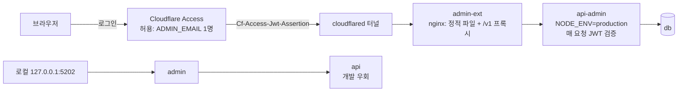

# 관리 앱 외부 공개 (Cloudflare Access + 터널, 2026-11-26)

관리 앱(로컬 5202 의 `admin` 이 아니라 Access 검증 전용 `admin-ext` 컨테이너)을 외부(예: `admin.k-raildex.com`)에서 쓰되 **관리자 본인만** 들어오게 한다(C-9, Q80 A, NFR-OPS-010).

## 1. 구성



- 이중 방어:
  1. **Cloudflare Access(엣지)**: 로그인하지 않았거나 허용 이메일이 아니면 터널까지 오지 않는다.
  2. **api-admin(원점)**: 운영 모드라 개발 우회가 없다. 매 요청 `Cf-Access-Jwt-Assertion` 의 서명(팀 공개키)·audience(AUD)·issuer·만료·이메일(= `ADMIN_EMAIL`)을 검증한다. 하나라도 틀리면 401/403.
- 로컬 `admin`·`api`(개발 우회)는 터널에 넣지 않는다. 공개 호스트 이름을 실수로 그쪽에 이어도 api 는 Cloudflare 를 거친 요청(`Cf-Connecting-Ip`·`Cf-Ray` 헤더)에는 개발 우회를 쓰지 않아 401 이 난다.
- `admin-ext`·`api-admin` 은 포트를 게시하지 않는다(터널만 접근). `.env` 에 `CF_ACCESS_AUD` 가 있으면 `pnpm stack:up` 이 프로필 `admin-ext` 를 켠다.

## 2. Cloudflare 에서 할 일(관리자)

순서가 중요하다 — **Access 애플리케이션을 먼저 만들고**, 공개 호스트 이름은 그다음에 연결한다.

1. Zero Trust 대시보드 → **Settings → Authentication**: 로그인 방법을 정한다(기본 One-time PIN = 이메일 코드. Google 로그인을 붙여도 된다).
2. **Access Control(예전 메뉴 이름 Access) → Applications → Add an application → Self-hosted**
   - Add public hostname: Subdomain `admin`, Domain `k-raildex.com`(원하는 하위 도메인)
   - Session duration: 예 24 hours
   - Policy: Action **Allow**, Include → **Emails** → 관리자 이메일 1개(= `.env` 의 `ADMIN_EMAIL`)
   - 저장 뒤 애플리케이션 개요의 **Application Audience (AUD) Tag** 를 복사한다.
3. 팀 도메인 확인: **Settings → Team and Resources**(또는 Custom Pages)에서 `<팀이름>.cloudflareaccess.com`. `.env` 에는 팀 이름만이 아니라 **전체 주소**를 넣는다.
4. **Networks → Connectors → Cloudflare Tunnels**(또는 Networks → Tunnels) → 기존 터널(k-raildex.com 을 공개 중인 것) → **Published application routes**(예전 Public Hostname) **→ Add**
   - Subdomain `admin`, Domain `k-raildex.com`, Service **HTTP** `admin-ext:80`
5. (지도 키) Google Maps 키의 HTTP 리퍼러 제한에 `https://admin.k-raildex.com/*` 를 더한다. VWorld 키도 등록 도메인에 관리 앱 주소를 더한다(없으면 그 배경만 안 나온다).

## 3. 서버에서 할 일

`.env`(커밋 금지)에 세 값을 넣고 다시 띄운다.

```bash
CF_ACCESS_TEAM_DOMAIN=<팀이름>.cloudflareaccess.com   # 전체 주소
CF_ACCESS_AUD=<복사한 AUD 태그>
ADMIN_EMAIL=<Access 정책의 이메일>
pnpm stack:up     # admin-ext · api-admin 이 함께 뜬다
```

## 4. 확인

- 시크릿 창에서 `https://admin.k-raildex.com` → Cloudflare 로그인 화면이 나와야 한다(바로 관리 앱이 보이면 2번이 빠진 것 — 터널 호스트 이름을 지운다).
- 로그인 뒤 대시보드 숫자가 보이면 정상. "인증 필요"·"Access 토큰 검증 실패"(401)면 AUD·팀 도메인, "허용되지 않은 사용자"(403)면 `ADMIN_EMAIL` 과 로그인 이메일을 확인한다.
- `curl -s -o /dev/null -w '%{http_code}' https://admin.k-raildex.com/v1/admin/station` → 302/403(Access 가 막음).
- 로그인 뒤 Cloudflare 오류(1033 등)·404 면 터널 경로가 없거나 `admin-ext:80` 이 아니다. 502 면 `admin-ext` 가 안 떴다(`.env` 값·`pnpm stack:up`).
- 2026-11-26 연결 완료(admin.k-raildex.com → 로그인 → 관리 앱 확인).

## 5. 변경 기록

관리 앱 외부에서 저장한 변경 묶음의 작성자는 Access 이메일의 관리자 사용자다(로컬 개발 우회의 `ADMIN_EMAIL` 기본값 `dev@localhost` 와 다를 수 있다 — 같은 이메일로 두면 같은 사용자).
